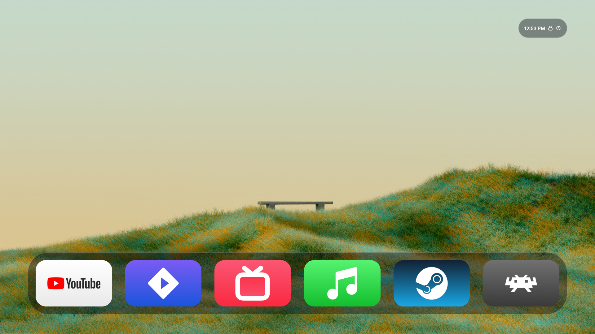
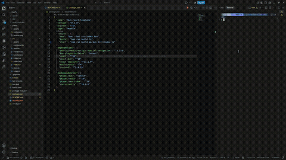

<div align="center"> 

# webTV

**A living-room launcher for your HTPC, built as a website.**

Controller- and remote-friendly. Fully themeable with Tailwind. Clone it, run it, make it yours.

<br /> <table> <tr> <td align="center" width="50%">  <br /> <sub>Home screen</sub> </td> <td align="center" width="50%">  <br /> <sub>Navigating and launching apps</sub> </td> </tr> </table> </div>

---

## What is it?

webTV is a big-screen, couch-friendly launcher inspired by modern streaming-box home screens. It simply renders a website in fullscreen, and that website can run commands on your machine to open apps. Point it at your HTPC or living room PC and use it as the front door to everything: media players, streaming apps, emulators, games, and anything else you can start from a command line.

## Features

- **Launcher for HTPCs and living room PCs**: open any app by running a command of your choice.
- **Fullscreen web UI**: runs as a regular website, so it works anywhere a browser does.
- **Highly customizable**: the interface is built with Tailwind CSS, so you can restyle layouts, colors, fonts, spacing, and animations far beyond what typical launcher apps allow.
- **Simple JSON config**: add your commands, change the background, and tweak behavior from a single file.
- **Remote and gamepad friendly navigation**: spatial navigation designed for directional input.
- **Easy setup**: clone, run one command, done.

## Getting started

```bash
git clone https://github.com/<your-username>/webTV.git
cd webTV
npm install
npm run start

```

`npm run start` builds the project and starts the server. Open the address printed in the terminal in a browser and put it in fullscreen (or use a kiosk-mode browser on your living room PC).

### Development

The dev script uses [Bun](https://bun.sh) with hot reloading:

```bash
bun install
npm run dev

```

## Configuration

Everything you are likely to change lives in **`public/config.json`**. From there you can:

- add your own app entries and the commands that launch them
- change the background
- adjust other launcher settings

An entry generally pairs a label and icon with a command to run, along the lines of:

```json
{
  "name": "Media Player",
  "image": "/assets/apps/media.png",
  "backgroundImage"?: "/assets/apps/backgrounds/app_background.png",
  "cliCommand": "vlc"
}
```

> **To use any changes to this configuration, you must restart the application.**

## Customizing the UI

Because the interface is plain React plus Tailwind, you are not limited to a fixed set of themes. Edit the components under `src/`, change Tailwind classes, add your own styles, and rebuild. Want a different layout, bigger tiles, glassy panels, or a totally different look? It is all just markup and utility classes.

## Scripts

Command

What it does

`npm run dev`

Starts the dev server with hot reload (Bun)

`npm run build`

Builds the project into `dist/`

`npm run start`

Builds, then runs `dist/server.js`

## Tech stack

- [React 19](https://react.dev)
- [Tailwind CSS 4](https://tailwindcss.com)
- [Zustand](https://github.com/pmndrs/zustand) for state
- [Norigin Spatial Navigation](https://github.com/NoriginMedia/Norigin-Spatial-Navigation) for remote/gamepad focus handling
- [React-Toastify](https://fkhadra.github.io/react-toastify/) for notifications
- [Bun](https://bun.sh) for dev and build tooling

## Acknowledgements

webTV is inspired by [Flex Launcher](https://github.com/complexlogic/flex-launcher) by complexlogic, a fantastic lightweight launcher for HTPCs. Go give it a star.
